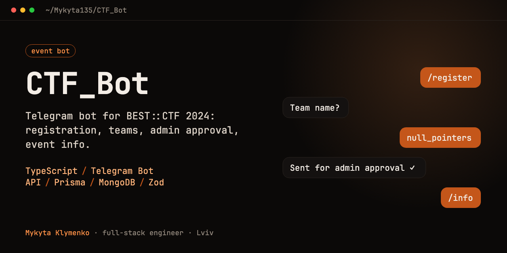

# CTF_Bot

The Telegram bot for **BEST::CTF 2024**, the first offline CTF in Lviv, run by BEST Lviv. Participants registered, formed teams and got event info through it; organisers approved teams and managed users from an admin menu.

## What it does

**For participants**
- Registration: name, university, group, year, how they heard about the event
- Create a team or join one with a team code
- Submit the team's qualification task; the team gets through once organisers accept it
- Event info, rules, location, and a chat with organisers

**For organisers**
- Review and approve teams and their qualification tasks
- Manage users, including blocking
- Switch the bot into event mode when the competition starts

## How it's built

The bot is a set of scenes, one per screen of the conversation. Each user's place in the conversation is stored in the database, and all input is validated with Zod before it's saved.

```
bot.ts                 # entry point, routes updates to scenes
scenes/userScenes/     # registration, teams, qualification task, event info, chat
scenes/adminScenes/    # team approval, user management, event start
schemas/               # Zod validation of user and team input
utils/keyboards/       # inline keyboard layouts
utils/database/        # queries per scene
prisma/schema.prisma   # User and Team models
```

## Run

```bash
npm install
npx prisma generate
npm run dev
```

Needs `TELEGRAM_TOKEN` and a MongoDB `DATABASE_URL` in the environment (validated with Zod at startup). Admins are an allowlist of Telegram chat ids in `ADMIN_CHAT_IDS` (comma-separated); `/admin` opens the panel only for those chats, and a broadcast is taken only from the admin who started it.

## Stack

TypeScript · Node.js · Telegram Bot API · Prisma · MongoDB · Zod
